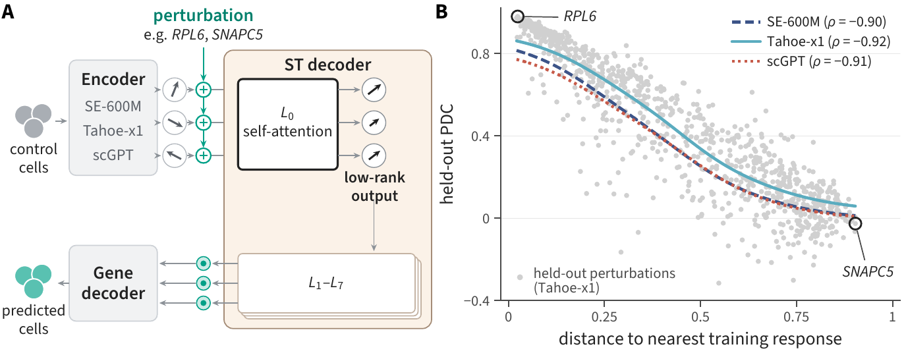

# A low-rank decoder bottleneck bounds reliability in foundation-model perturbation prediction

Code for the NeurIPS 2026 paper ([arXiv:2611.05849](https://arxiv.org/abs/2611.05849)).



*(A) An encoder embeds control cells and the ST decoder predicts their response to a perturbation;
the decoder's first attention layer has a low-rank output. (B) On HepG2, per-perturbation accuracy
(PDC) falls with the distance from a held-out response to the nearest training response.*

The paper audits the state-transition (ST) decoder of STATE with three frozen cell encoders
(SE-600M, scGPT, Tahoe-x1) on four Replogle-Nadig CRISPRi cell lines, and proposes
predicted-NN-distance as a per-prediction confidence score. This repository contains:

- `src/lowrank_reliability/`: the library. `audit/` has PyTorch hooks that project the output of
  the decoder's first attention layer onto a few directions or replace its directions with those of
  another model, and the ridge probe on the decoder's inputs; `score.py` computes
  predicted-NN-distance; `calibrate.py` fits the pooled threshold and the Learn-then-Test threshold;
  `metrics.py` and `stats.py` compute PDC and paired bootstrap intervals.
- `examples/`: scripts that run the paper's experiments on a trained checkpoint.
- `tests/`: unit tests.

## Install

```bash
conda env create -f environment.yml && conda activate lowrank-reliability
# or, with Python 3.10 or later:
pip install -e ".[audit,test]"
pytest
```

The scripts that load STATE checkpoints also need `pip install arc-state==0.10.4`.

## Data and checkpoints

```bash
export DATA_DIR=/path/to/data
# Replogle-Nadig CRISPRi (K562, RPE1, HepG2, Jurkat) with the STATE few-shot splits
huggingface-cli download arcinstitute/State-Replogle-Filtered --repo-type dataset \
    --local-dir $DATA_DIR/State-Replogle-Filtered
# SE-600M encoder and Arc's released SE+ST few-shot decoders
huggingface-cli download arcinstitute/SE-600M        --local-dir $DATA_DIR/SE-600M
huggingface-cli download arcinstitute/ST-SE-Replogle --local-dir $DATA_DIR/ST-SE-Replogle
# Arc's released ST model on Tahoe-100M and its evaluation outputs
huggingface-cli download arcinstitute/ST-SE-Tahoe    --local-dir $DATA_DIR/ST-SE-Tahoe
# Tahoe-x1 tx-70m encoder
huggingface-cli download tahoebio/Tahoe-x1 --include "70m/*" --local-dir $DATA_DIR/tahoe-x1
```

The scGPT whole-human checkpoint (`scGPT_human`) is in the scGPT model zoo
(https://github.com/bowang-lab/scGPT).

## Training the decoders

SE+ST uses Arc's released few-shot checkpoints. For scGPT+ST and Tahoe+ST, compute each cell's
embedding with the encoder, store it in `obsm` of the dataset's `.h5ad` files, and train the
decoder with arc-state 0.10.4 using the configuration of Arc's released checkpoint, changing only
the input embedding:

```bash
state tx train \
    data.kwargs.toml_config_path=<few-shot TOML of the cell line> \
    data.kwargs.embed_key=<obsm key of the encoder embedding> \
    data.kwargs.output_space=gene data.kwargs.basal_mapping_strategy=random \
    data.kwargs.batch_col=gem_group data.kwargs.pert_col=gene \
    data.kwargs.cell_type_key=cell_line data.kwargs.control_pert=non-targeting \
    model=state model.kwargs.cell_set_len=64 model.kwargs.hidden_dim=328 \
    model.kwargs.n_encoder_layers=1 model.kwargs.n_decoder_layers=1 \
    model.kwargs.batch_encoder=true \
    training.max_steps=100000 training.batch_size=64 training.lr=0.001 \
    training.val_freq=2000 training.gradient_clip_val=10 \
    output_dir=<output directory> name=<run name>
```

Training one decoder takes 4 to 8 hours on one GPU.

## Usage

```bash
python examples/quickstart.py   # synthetic data, runs in seconds without a checkpoint
```

| Script | Paper |
|---|---|
| `examples/quickstart.py` | predicted-NN-distance and Learn-then-Test (Section 4.3) |
| `examples/keep_k_audit.py` | projection of the first-layer output onto k directions (Table 1, Figure 2) |
| `examples/direction_patching.py` | replacing first-layer directions with those of another model (Section 4.2) |
| `examples/ridge_readout.py` | ridge probe on the decoder's inputs (Table 1) |

Each script lists its options with `--help`.

## Citation

```bibtex
@inproceedings{zhang2026lowrank,
  title={A low-rank decoder bottleneck bounds reliability in foundation-model perturbation prediction},
  author={Zhang, Zheyu and Huang, Yuanhao and Feng, Fan and Liu, Jie},
  booktitle={Advances in Neural Information Processing Systems},
  year={2026}
}
```

## Acknowledgments

This code builds on open-source software and data: STATE and its training code
[arc-state](https://github.com/ArcInstitute/state), [cell-load](https://github.com/ArcInstitute/cell-load)
and [cell-eval](https://github.com/ArcInstitute/cell-eval) from the Arc Institute, which also released
the SE-600M encoder, the ST checkpoints and the processed Replogle-Nadig data;
[scGPT](https://github.com/bowang-lab/scGPT); [Tahoe-x1](https://github.com/tahoebio/tahoe-x1); and
the Perturb-seq screens of Replogle et al. (2022) and Nadig et al. (2025).

## License

MIT (see `LICENSE`).
